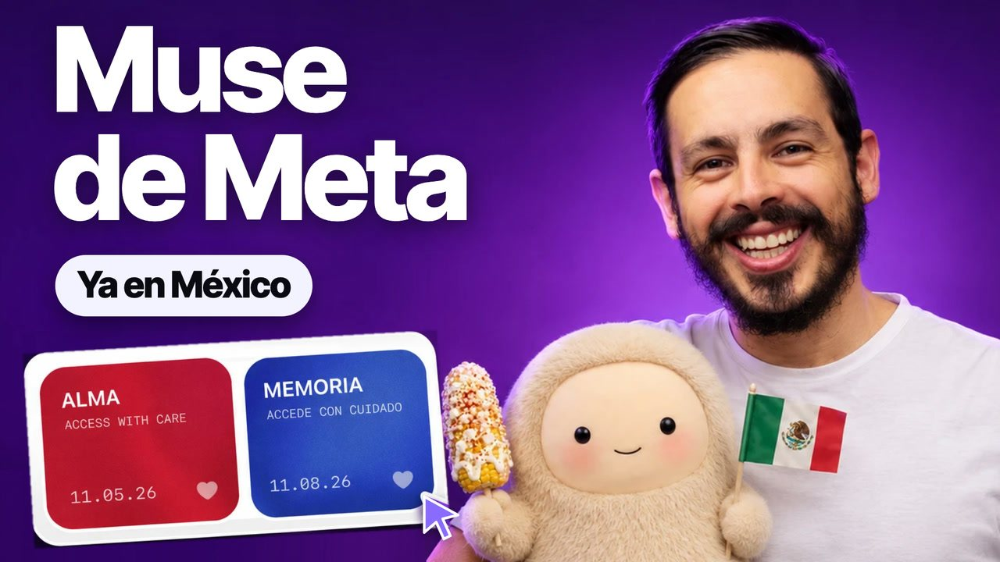
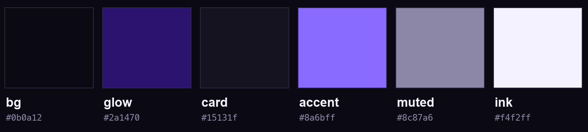
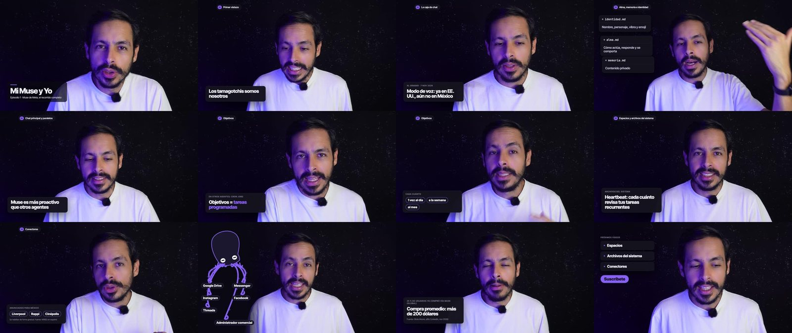
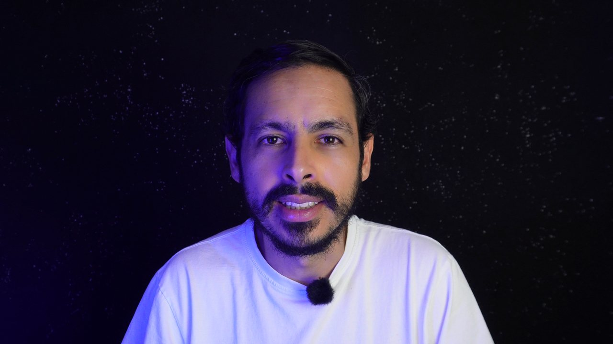
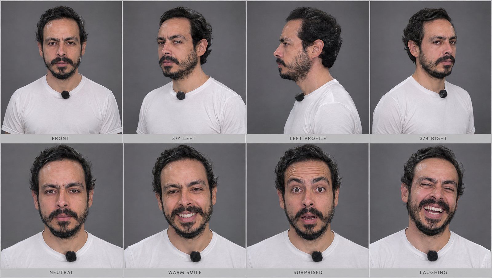
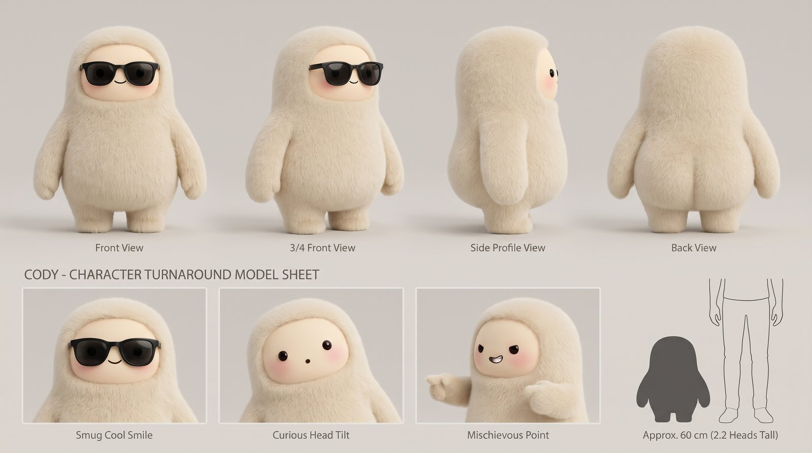
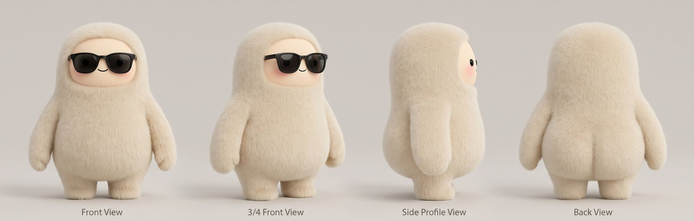
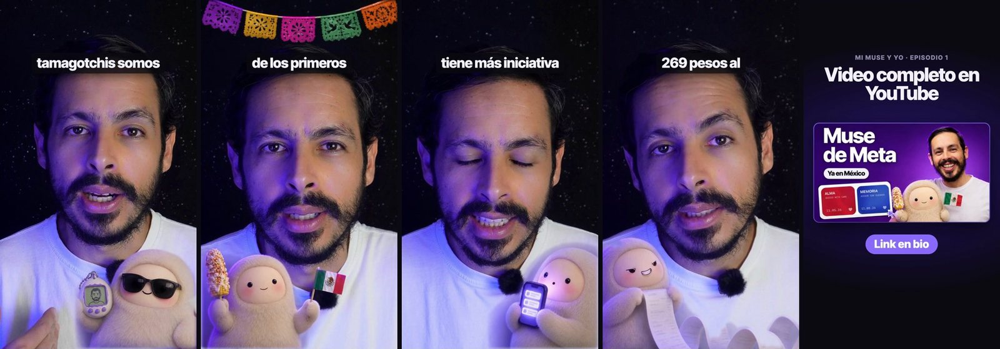

# marca-pablo-video

Skill de marca de **Pablo Paredes** para Claude: define cómo se ve y cómo suena cada video, reel o miniatura
del canal **«Mi Muse y Yo»**. Va encima de una skill de proceso
([video-largo-y-teaser](https://github.com/wavexlabs-dev/video-largo-y-teaser), `video-short`, `html-reel` o
[estudio-video-codigo](https://github.com/wavexlabs-dev/estudio-video-codigo)). La de proceso dice *cómo* se edita;
esta, *cómo se ve Pablo*.



## Paleta «Nocturno morado»

Viene del set real: fondo negro, luz morada detrás y playera blanca. La fuente de verdad en código es `assets/plantillas/tokens.ts`.



El morado se usa con mesura: solo en la palabra que es el punto del rótulo. Los títulos de capítulo van todos en blanco.

## Tipografía

- **Inter Tight** 400 / 600 / 800 para todo (titulares en 800 con tracking −0.03 em)
- **JetBrains Mono** 400 / 500 solo para archivos, código y el número de la píldora
- Nunca serif ni itálica decorativa, y nunca dos familias en un mismo título

Los archivos `.woff2` están en `assets/fuentes/` (licencia SIL OFL 1.1).

## Piezas gráficas y set

Píldora de capítulo, separadores, tarjeta de pantalla con burbuja de cámara y rótulos en la columna libre (x ≤ 600 px).



| Set real | Ficha de Pablo |
|---|---|
|  |  |

Encuadres: medio (cuadro completo), cerrado a 1.2× como máximo y desplazado para dejar libre la columna de gráficos.
En vertical se usa el alto completo del 4K (1215×2160 → 1080×1920).

## Cody, la mascota

El Muse de Pablo: felpa color crema, silueta de frijol, unos 60 cm de alto (le llega arriba de la rodilla), sin cuello ni dedos. Cuando sale, la ficha siempre va como referencia.




## Reels

Subtítulos de 2–3 palabras, Cody del lado libre y cierre con la miniatura que manda a YouTube.



## Sonido y voz

- YouTube a −15 LUFS y reels a −12 LUFS, con pico de −1.5 dBTP. La música baja 4 dB bajo la voz y sube 5 dB en los separadores.
- Español de México, directo y cercano, con analogías (el pulpo sin tentáculos, el tamagotchi).
- Antes de generar cualquier cosa con IA se cotiza en dólares. Cada ronda de notas es una versión nueva. La privacidad la decide Pablo.

## Qué incluye

```
SKILL.md
references/  identidad-visual · camara-y-sonido · serie-y-voz · cody
assets/
  fuentes/     Inter Tight, JetBrains Mono (woff2)
  plantillas/  tokens.ts, mmy.ts, separators.ts, style.css, music.json, thumb.html + render.mjs
  cody/        hoja B, turnaround, vistas de la app
  pablo/       fotos de referencia, cuadro del set, ficha
docs/        imágenes de este README
```

## Instalación

```bash
git clone https://github.com/wavexlabs-dev/marca-pablo-video ~/.claude/skills/marca-pablo-video
```

Uso: «hazme un reel del episodio 2» o «haz la miniatura del EP2». Claude carga esta skill junto con la de proceso.

---
Repositorio privado: contiene fotos de Pablo y su personaje. Las fuentes se distribuyen bajo la SIL Open Font License.
