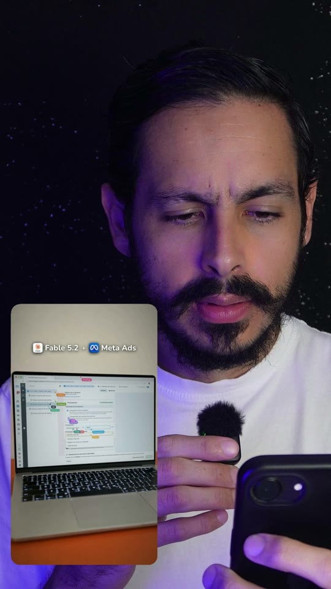

# ¿Es real o es hype?

Serie de Shorts 1080x1920 donde Pablo toma un video viral sobre IA, lo pone a prueba y dice si es real o es
hype. Todo lo necesario vive en esta skill: no hace falta cargar `video-short` ni `marca-pablo-video`.

## Cómo trabajar con Pablo
- Español de México, directo. Recomienda una opción; no hagas cuestionarios largos.
- Enséñale borradores pronto y deja que comente. Manda siempre la **copia 1080 ligera** (<30 MB) con
  `SendUserFile`; el master completo va por AirDrop si pesa más.
- Tú no puedes oír: el jingle, la música, los ruidos y el volumen los juzga él. Mándale el audio y pregunta.
- Cualquier generación con IA (música, imágenes) o renta de GPU: cotiza en dólares o créditos y pide permiso.
- Respalda en `borradores/` antes de cada render final (render.py final borra versiones anteriores).

## Flujo de un episodio
1. **Brief** — el video viral (archivo o liga), qué afirma y qué es en realidad. Lee
   [references/formato.md](references/formato.md) y propón el guion con
   [references/guion.md](references/guion.md): las tomas que Pablo tiene que grabar y la grabación de pantalla.
2. **Preparar** — proxy 1080 de los clips Sony, velocidad 1.2x si la quiere, fuente en orden de historia.
   Todo en [references/produccion.md](references/produccion.md).
3. **Apertura** — `scripts/apertura.sh` con su reacción en silencio y el reel. El acomodo es **fijo**; no
   propongas otro. Ver la sección «Apertura fija» abajo.
4. **edit.md** — cortes, escenas y plantillas de `assets/plantillas/` (título y veredicto). Ejemplo completo:
   `assets/ejemplo-ep1/edit.md`.
5. **Borrador** — `motor/scripts/render.py --draft`, luego `scripts/ajustar_subtitulos.py` y
   `scripts/tira_cortes.sh`. Revisa cada corte antes de mandarlo (ver [references/errores.md](references/errores.md)).
6. **Voz** — exporta la voz, Pablo la limpia en Adobe Podcast, se reemplaza.
   Ver [references/audio.md](references/audio.md).
7. **Final** — `render.py` final, `scripts/mezcla_final.sh` (jingle + audio del reel + −13 LUFS),
   `motor/scripts/qa.py`, `scripts/copia_ligera.sh`.
8. **4K** (si lo pide) — [references/render-4k.md](references/render-4k.md).
9. **Copy** — caption para el reel con [references/guion.md](references/guion.md#copy).

Marca (colores, tipos, zonas, subtítulos): [references/marca.md](references/marca.md).
Motor de edición (comandos, sintaxis de `edit.md`, gráficos): [motor/reference.md](motor/reference.md) y
[motor/proceso-video-short.md](motor/proceso-video-short.md). En la primera vez corre `motor/scripts/setup.sh`.

## Lo esencial (si solo lees esto)
- Hook sin texto ni jingle: Pablo viendo el reel en silencio + el audio original del reel.
- Él dice «¿Es real o es hype?» y el título aparece a pantalla completa, sin él a cámara; el jingle suena
  **después** de su frase, no encima.
- Veredicto con sello HYPE o REAL y dos renglones (✕ lo falso, ✓ lo que sí es).
- Pruebas con su propia grabación de pantalla, nunca con material inventado; si algo es IA, se rotula.
- Fondo `#0b0a12`, texto `#f4f2ff`, morado `#8a6bff` solo en la palabra clave. Inter Tight 600/800.
- Entrega −13 LUFS, pico ≤ −1.5 dBTP, 1.2x si Pablo lo confirma.

## Apertura fija (no cambiarla)

Así queda el primer cuadro de cada episodio (EP1, `assets/ejemplo-ep1/apertura_ep1.jpg`):
- Pablo a **pantalla completa** viendo el celular, con zoom 1.3 a su toma; su cara completa, arriba y al centro.
- El reel viral como **tarjeta redondeada abajo a la izquierda** (470x836, esquinas de 30 px, en x=44, y=990):
  no tapa su cara y deja ver el celular en su mano a la derecha.
- Sin texto, sin título, sin jingle; solo el audio original del reel. Termina en su cara de duda, justo antes
  de que hable.
- Hazla siempre con `scripts/apertura.sh`; no la armes en `edit.md` con split, burbuja ni otro layout.
  Revisa `apertura_inicio.jpg` contra la imagen de ejemplo antes de seguir.
